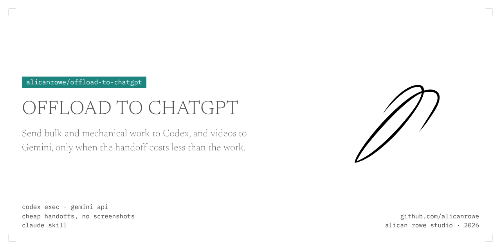

# Offload to ChatGPT

A Claude skill, now organised as "The Hive", for routing each task to the cheapest model that can do it well. It
sends bulk and mechanical work to ChatGPT/Codex, and videos, very long documents and second opinions to Gemini.
The rule at its core: only hand work off when the handoff costs less than the work, and do it by command line
(`codex exec`, the Gemini API) rather than by driving an app with screenshots.

What it covers:

- A routing table: the Queen Bee (Claude Opus) keeps design and judgement, Scouts (Claude Haiku) do checks,
  Builders (Claude Sonnet) do routine edits, the Drone (a local Qwen model on the home tower, only when its GPU is
  idle) does free private bulk text, and the neighbouring hives (Codex CLI and the Gemini API) take
  offloaded coding, bulk work, videos and second opinions.
- Routing rules: route by task type before starting, hand down a brief and get back a file, cascade cheap-first,
  have a different model cross-review, batch calls, and keep private material with Claude.
- Setting up the Codex CLI signed in with a ChatGPT account, and an OpenAI API key with a spending cap.
- The helper `scripts/ask_gemini.py` for text, files, images and PDFs, which falls back across flash models
  when one is busy or unavailable.
- Getting a timestamped breakdown of a video from Gemini: YouTube links directly, other links by downloading
  the clip in a remote sandbox first.
- How to write a one-shot brief and spot-check what comes back.

See `SKILL.md` for the full steps.
